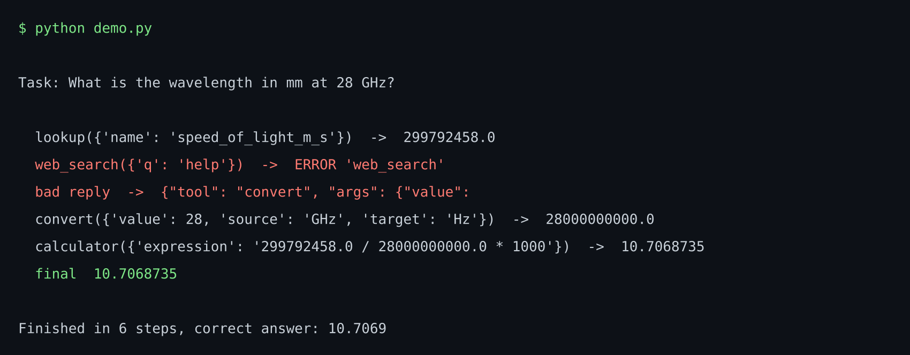
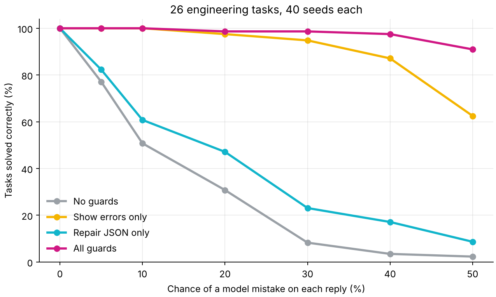
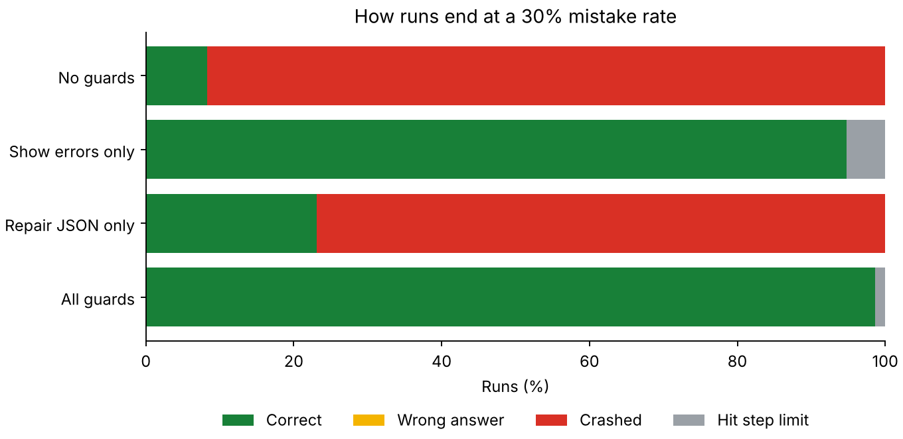
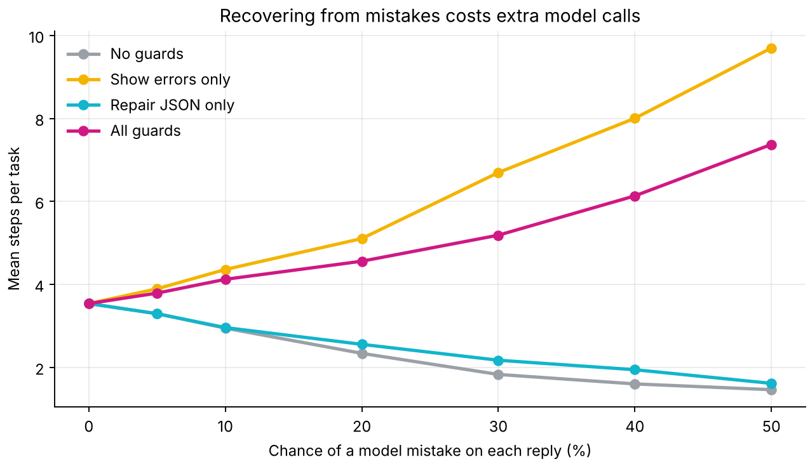
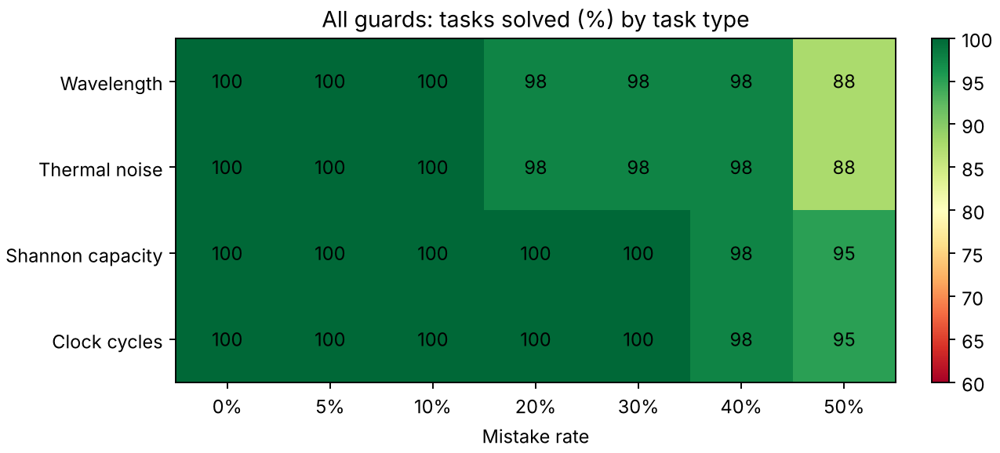
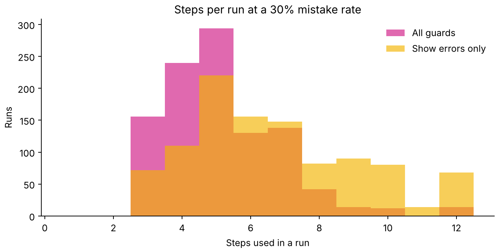
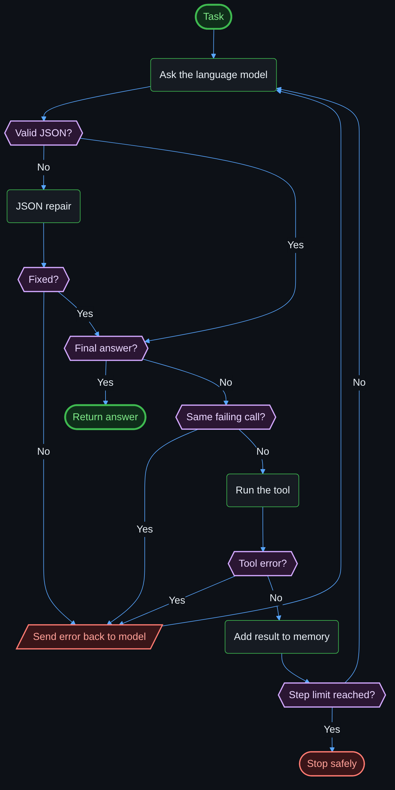

# AI Agent From Scratch in Python

**How does an AI agent really work? About 150 lines of plain Python, with no framework.** It also measures the part most tutorials skip: what keeps an agent working when the model makes mistakes.



## Key results

26 engineering tasks with known answers, 40 seeds each, so 1,040 runs per point. Injected mistakes include broken JSON, invented tools and wrong arguments.

| Guards | No mistakes | 10% mistakes | 30% mistakes | 50% mistakes |
|---|---:|---:|---:|---:|
| None | 100.0% | 50.8% | 8.3% | 2.3% |
| Repair JSON only | 100.0% | 60.8% | 23.1% | 8.7% |
| Show errors to the model | 100.0% | 100.0% | 94.8% | 62.5% |
| All guards | 100.0% | 100.0% | 98.7% | **91.0%** |

What this shows:

- Without guards, a 30% mistake rate breaks **more than 9 of every 10 runs**.
- The most useful guard is the simplest one: give the error back to the model so it can try again.
- Guards take more steps. At 50% mistakes, the guarded agent uses about 7.4 steps per task.



| How runs end at 30% mistakes | Extra model calls |
|---|---|
|  |  |

| Results by task type | Steps per run |
|---|---|
|  |  |

At a 30% mistake rate, 954 of 1,040 runs with no guards crash. With all guards, 1,026 finish correctly and the other 14 hit the step limit, with no crashes and no wrong answers.

## The agent loop

```text
task -> model -> JSON action -> run tool -> result -> model -> ... -> final answer
```

## The guards

| Guard | What it does |
|---|---|
| JSON repair | Pulls JSON out of prose and fixes trailing commas and quotes |
| Error feedback | Sends tool and parsing errors back to the model |
| Repeat blocking | Refuses the same failing call twice in a row |
| Step limit | Always stops a stuck model |
| Safe calculator | Walks the syntax tree and never calls `eval()` |

## Flowchart

<p align="center"></p>

## Run it

```bash
pip install -r requirements.txt

python demo.py            # no model needed
python benchmark.py       # repeat the study, about 10 seconds
pytest tests

python demo.py --ollama   # local model through Ollama
```

## Files

| File | Purpose |
|---|---|
| `agent.py` | Loop, tools and guards |
| `llm.py` | Ollama client and the scripted fault injector |
| `benchmark_tasks.py` | Tasks with known answers |
| `benchmark.py` | Study and charts |

## Limits

- **The results come from a scripted planner, not a real language model.** It follows a correct plan and injects mistakes, so it tests the guards and not model intelligence.
- Real models make other kinds of mistakes, such as wrong plans, which these guards do not catch.
- The Ollama client has not been tested against a live server.
- The tasks are small and use only three tools.

## Author

Jaafar Salim, University of Technology, Iraq

Topics: AI agents, LLM, function calling, tool use, Ollama, agentic AI, Python.
